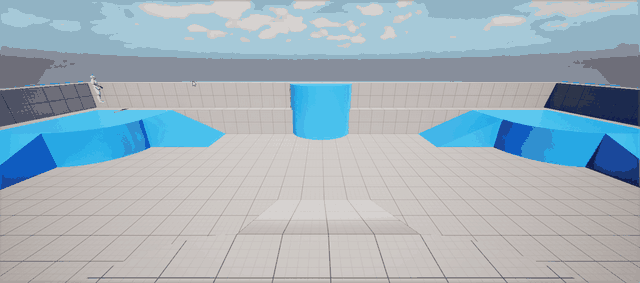

# Impulse

A top-down shooter prototype I made in Unreal Engine 5 using C++.

## What's in it

- WASD movement using the Enhanced Input system
- The player turns to face the mouse cursor and shoots where it's pointing
- Projectiles with collision that deal damage on hit
- Enemies that chase the player using the NavMesh and die when their health runs out
- A separate top-down camera that smoothly follows the player

## Controls

| Input | Action |
| --- | --- |
| W A S D | Move |
| Mouse | Aim |
| Left mouse button | Shoot |

## Code

The project started from Unreal's Top Down template. The gameplay classes I wrote are in [`Source/Impulse`](Source/Impulse):

| Class | What it does |
| --- | --- |
| `MyPlayerCharacter` | Movement, cursor aiming, and spawning projectiles |
| `MyProjectile` | Projectile movement, collision, and damage |
| `EnemyCharacter` | Chases the player, takes damage, and dies |
| `TopDownCameraActor` | Camera that follows the player with smoothing |
| `MyGameModeBase` | Tracks the round state and ends the round when the last enemy dies |

## Running it

1. Install Unreal Engine 5.7 and Visual Studio 2022 with the "Game development with C++" workload.
2. Clone the repo, right-click `Impulse.uproject`, and choose **Generate Visual Studio project files**.
3. Open `Impulse.uproject`, click **Yes** when it asks to rebuild modules, then press **Play**.
